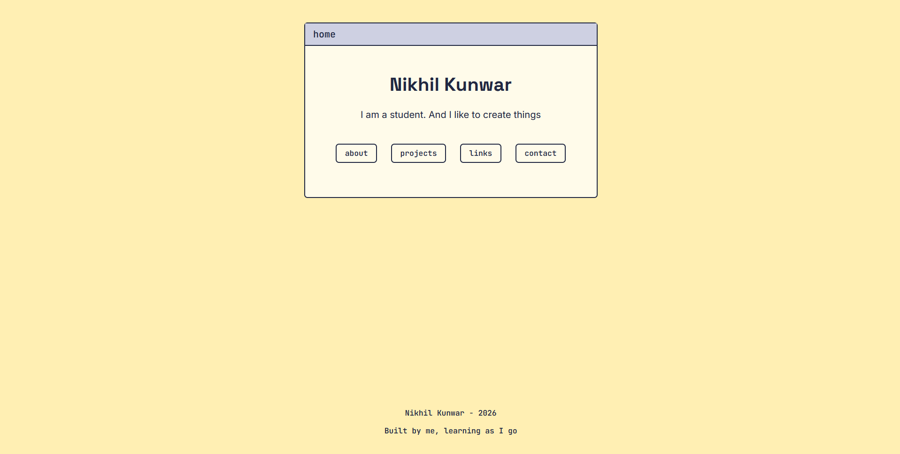
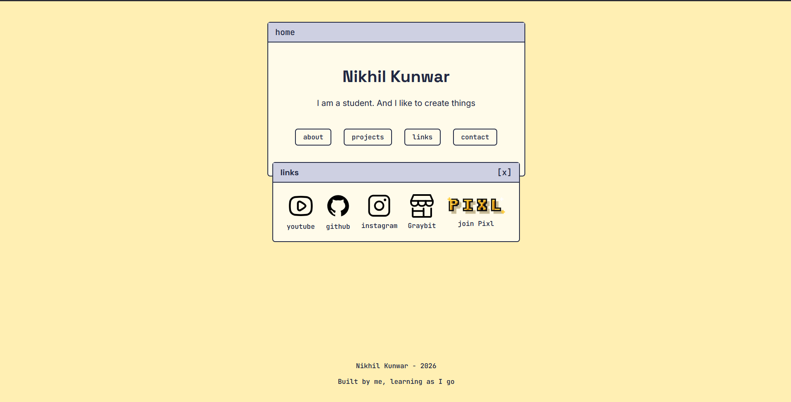
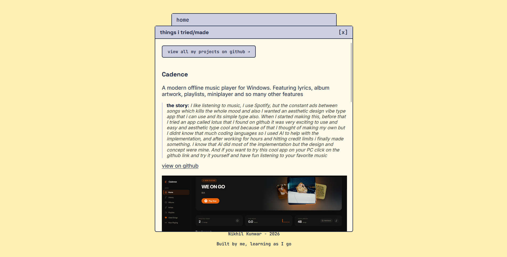

# Raise your Builder Page
My personal website.

## What it is
A personal website where you can read about me (my story), my projects, go through my channel links, and a contact option to get in touch with me.

The site is a single page with a small window in the middle and four buttons.

- "about" -> where you can read about me.
- "projects" -> showcasing some projects I built and a GitHub link on top to see all the other projects I built and building right now.
- "links" -> find me on other platforms.
- "contact" -> contact me through this.

## Live demo
[Live Website](https://nikhilkshub.github.io/raise-your-builder-page/)

## Screenshots
These are just a few of the pages. The rest you’ll have to find by clicking around yourself.
### Homepage

### Links

### Projects

## Built with
- HTML AND CSS
- Icons - they were taken from free Icon websites
- Fonts - Google Fonts (eg:- Flaticon, Freeicons etc) 

## How to run it 
Though, I highly doubt you’ll ever actually need to run my personal site on your own machine...
but still here you go :- 

No install or build step needed, since it's static HTML/CSS.
1. Clone the repo
2. Open `index.html` directly in a browser.

## Things I want to improve
- Maybe adding new ways to contact me right now its just email.
- Light/dark theme toggle option
- current idea/currently working section(where i can show what i am doing currently)
- and maybe some more design or animation 

## AI usage
- Concept and layout decisions (the desktop/window idea, color palette, typography) were mine, developed through back-and-forth discussion and so many online inspirations 
- CSS concepts were explained to me (flexbox, the box model, `:target`, pseudo-elements) and I wrote the actual code myself based on those explanations and whenever I got stuck I took help from claude.
- Debugging help when things weren't working (e.g. a flexbox sizing quirk with `max-width`)
- Wording feedback on a few lines of copy (the About page intro, project descriptions)

## Author
NIKHIL KUNWAR
[MY WEBSITE](https://nikhilkshub.github.io/raise-your-builder-page/)
